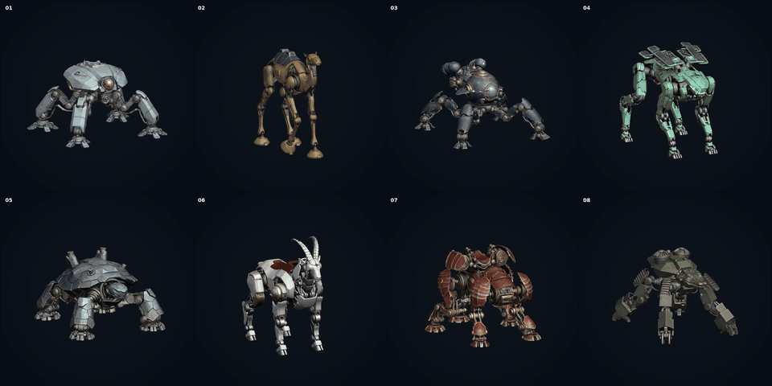
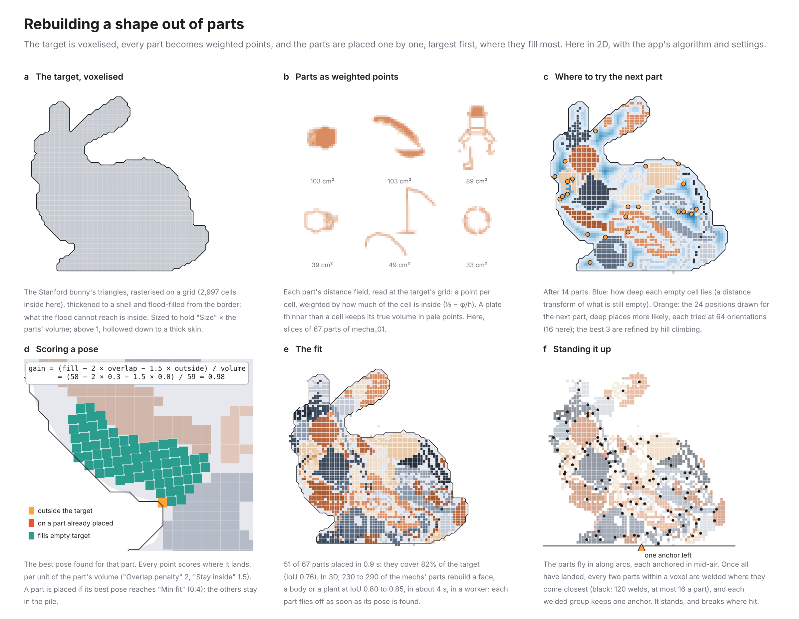
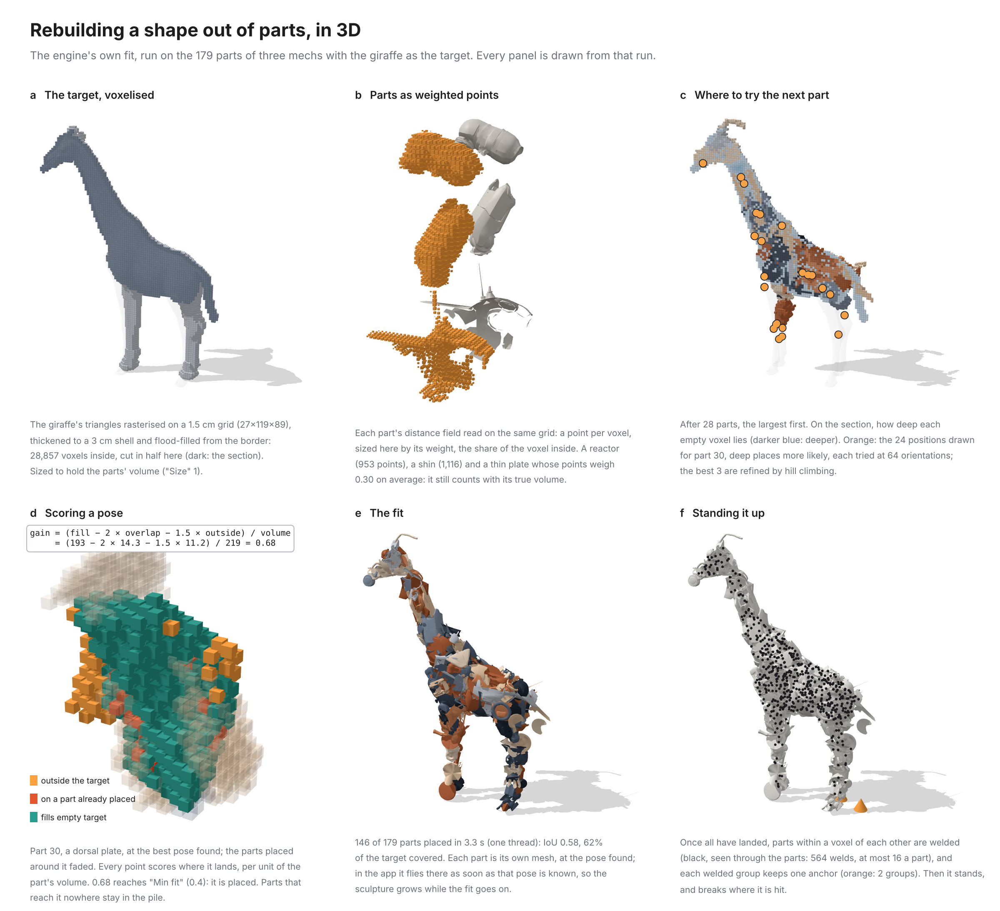
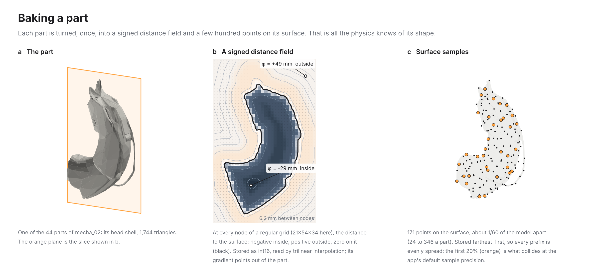
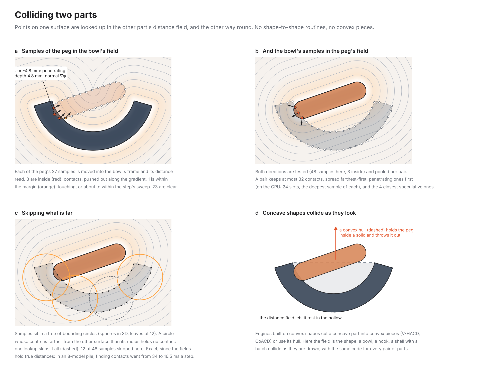
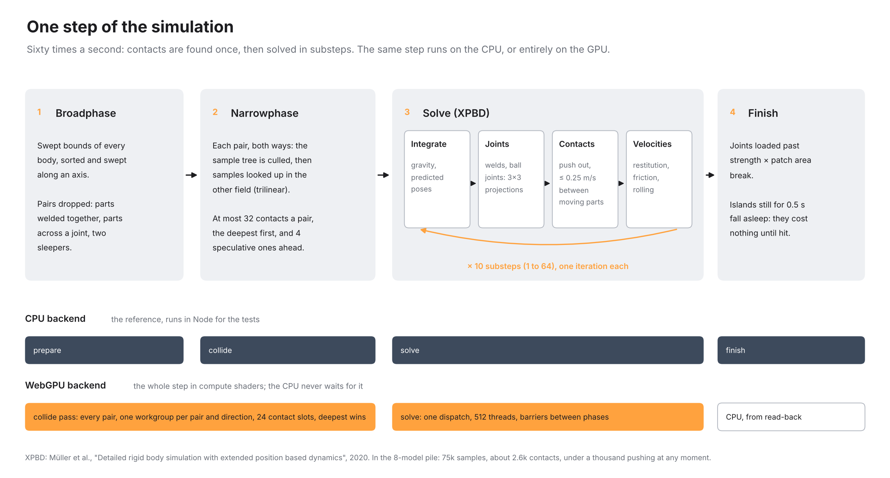

# Assemblage

[](https://storage.googleapis.com/nicoptere/2026/assemblage/index.html)

Take machines apart and rebuild them into other shapes, in the browser. A rigid-body physics engine where every part
collides exactly as it looks.

**[Open the live demo](https://storage.googleapis.com/nicoptere/2026/assemblage/index.html)**

Seven mechs, 44 to 87 parts each. Drop one, shoot it, blow it up, then rebuild its parts into a box, a sphere, the
Stanford bunny or a giraffe. Drop your own GLB, OBJ or STL on the page: it is split into parts and baked in a few
seconds, in the browser.

Underneath is a physics engine written for this. Every part is a **signed distance field** and a few hundred
**surface samples**; a collision is one part's samples looked up in the other's field. No convex decomposition, no
routine per pair of shapes: a bowl, a hook or a hollow shell collides as it is drawn. An XPBD solver, joints that
break, sleeping bodies, on the CPU or entirely in **WebGPU**. Plain JavaScript and three.js.

## Breaking

A mech is its parts held together by joints, found where the parts touch: welds inside a limb segment, ball joints
at the hips, knees and shoulders (held at their pose by a soft drive, so the mech stands). Every step, each joint
measures the force and torque it carries; past its strength it breaks, and what it held comes apart.

A joint's strength is the joint strength setting (5 MPa by default) times the area of its contact patch, but never
less than a margin over the load it carried while the mech settled under its own weight, in its first half second,
when no joint can break. So any mech that can stand keeps standing, and only extra loads break it: a ball, a blast, a drag, a fall.

| To | With a mouse and keys | On a touch screen |
|---|---|---|
| Shoot a ball (2 cm, 80 m/s, three times as dense as steel) | `Space` at the cursor | tap |
| Blow up what is under the cursor | double click, or `X` | double tap |
| Pull a part | drag it | drag it |
| Remove the part dragged | `Del` | |
| Take the mechs apart, joint by joint | `D` | |
| Reset, clear, pause | `R`, `C`, `P` | |

A blast on a part blows up the piece it still belongs to; on a rebuilt sculpture, the whole sculpture; on the floor,
the pile around it; in the sky, the whole scene.

## Rebuild

**Rebuild** (or `G`) fits the parts lying in the scene into a target shape. Hold the button for the gallery of
targets; its last tile takes a mesh of your own.

The target mesh is voxelised and filled; every part becomes weighted points on the same grid. Largest first, each
part is tried at positions drawn deep in what is still empty and at 64 orientations, scored by how much empty target
it fills against overlap and overhang, refined by hill climbing, and placed if it scores enough. Each part flies to
its pose as soon as it is found. The sculpture is then welded where parts touch, each welded group keeps one anchor,
and it breaks like a mech.





## Run

Needs [Node.js](https://nodejs.org) 20.19 or newer. The app uses WebGPU where the browser has it (Chrome, Edge) and
the CPU engine elsewhere.

```bash
git clone https://github.com/nicoptere/assemblage.git
cd assemblage/engine
npm install
npm run dev
```

Open <http://localhost:5173>; `?model=mecha_03` starts with another mech.

```bash
npm test          # the engine's tests, in Node ("does mecha_01 stand?" among them)
npm run build     # the site in engine/app/dist: static files that work from any folder
```

## SDF physics engine

### Bake

Each part is turned, once, into a **signed distance field** on a regular grid (about 6 mm a voxel: negative inside,
positive outside, zero on the surface) and **24 to 346 points on its surface**, stored farthest-first so that any
prefix is evenly spread. That is all the physics knows of a part's shape.



### Collide

One part's samples are moved into the other's frame and looked up in its field (trilinear), and the other way round.
A sample inside is a contact: its depth is the distance, its normal the field's gradient. Samples sit in a tree of
bounding spheres, so one lookup skips a whole group far from the other surface. Concave parts need no cutting into
convex pieces: the field is the shape.



### Step

Contacts are found once a step (broadphase, then narrowphase), then solved with XPBD in substeps: joints as full
3×3 projections, contacts, then velocities with friction and rolling resistance. Joints break past their strength;
bodies at rest fall asleep and cost nothing until hit. The CPU backend is the reference; the WebGPU backend runs the
whole step in compute shaders.



### Use it on its own

`engine/core` (`@sdfphys/core` in the workspace) has no DOM or three.js dependency; its CPU engine runs in Node too.

```js
import { World, RigidBody, PlaneShape, SphereShape, Assembly } from '@sdfphys/core';

const world = new World({ substeps: 10 });
world.addBody(new RigidBody({ shape: new PlaneShape(), type: 'static', friction: 0.9 }));

// a baked model: per part a distance field and surface samples, and the joints between the parts
const mech = await Assembly.load('models/mecha_01/manifest.json');
const robot = mech.spawn(world, { position: [0, 0.005 - mech.bounds.min[1], 0] });
world.on('jointBreak', ({ joint }) => console.log(`a ${joint.kind} joint broke`));

// a second later (joints cannot break in their first half second), a 4 kg steel ball at 30 m/s
setTimeout(() => world.addBody(new RigidBody({
  shape: new SphereShape(0.05), position: [0, 0.3, 2], velocity: [0, 0, -30], density: 7800, ccd: true,
})), 1000);

(function frame() {
  world.step(1 / 60);
  for (const part of robot.bodies) {
    // part.position (Vec3) and part.quaternion (Quat): draw it with your renderer
  }
  requestAnimationFrame(frame);
})();
```

On the GPU, the same world with another backend; a step is queued and never waits for the GPU:

```js
import { World, WebGPUBackend } from '@sdfphys/core/webgpu';

const backend = new WebGPUBackend();
await backend.init();
const world = new World({ backend });
// each frame: await world.stepAsync(1 / 60);
```

Besides baked models, shapes can be spheres, boxes, planes, or an `SdfGridShape` of your own field (`origin`, `dims`,
`voxel`, `data`, `samples`).

## More

How the mechs were made and split into parts, how to split them again with other settings, and how to bring your own
models and rebuild targets, with commands to copy: **[preprocess/README.md](preprocess/README.md)**.

The seven mechs are in [models/](models/) as plain GLB files, one node per part, free to use (CC0).

## Credits

- **Stanford Bunny** and **Armadillo**, from the [Stanford 3D Scanning Repository](https://graphics.stanford.edu/data/3Dscanrep/),
  Stanford University Computer Graphics Laboratory. The bunny was assembled by zippering range scans (Greg Turk and
  Marc Levoy, SIGGRAPH 1994); the armadillo was merged from 114 scans by volumetric integration (Venkat Krishnamurthy
  and Marc Levoy, SIGGRAPH 1996). Used for research and not for profit, as the repository allows: not to be used
  commercially or in a product for sale without the laboratory's permission. The repository's Dragon is left out, as
  it asks that the dragon not be shown broken or exploded.
- **Giraffe**: ["Goat Simulator Tall Goat"](https://sketchfab.com/3d-models/goat-simulator-tall-goat-1a06d450dade4d84b070a97ef6a13ec3)
  by ROAD Software, [CC BY 4.0](https://creativecommons.org/licenses/by/4.0/); posed by its skeleton and reduced to
  its triangles.
- **Kangaroo** and **killer whale**: from the "taschen" set of models.
- **Mechs**: made for this project, images with KREA 2 and models with Microsoft's TRELLIS.2, split into parts as
  [preprocess/README.md](preprocess/README.md) tells; [CC0](models/LICENSE).
- **Sounds**: two explosions from Kenney's Sci-Fi Sounds (CC0); impacts are synthesised.
- **Font**: Six Caps by Vernon Adams (SIL Open Font License).
- **Libraries**: three.js, glTF Transform and meshoptimizer (MIT), qrcode (MIT).

## License

The code is under the [MIT License](LICENSE). The mechs are dedicated to the public domain ([CC0](models/LICENSE)).
The other models, the sounds and the font keep their own terms, listed above.
