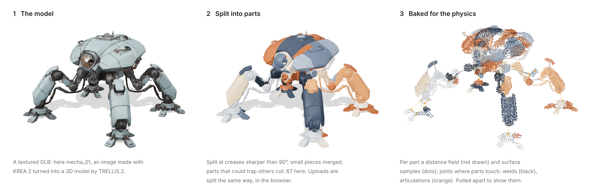
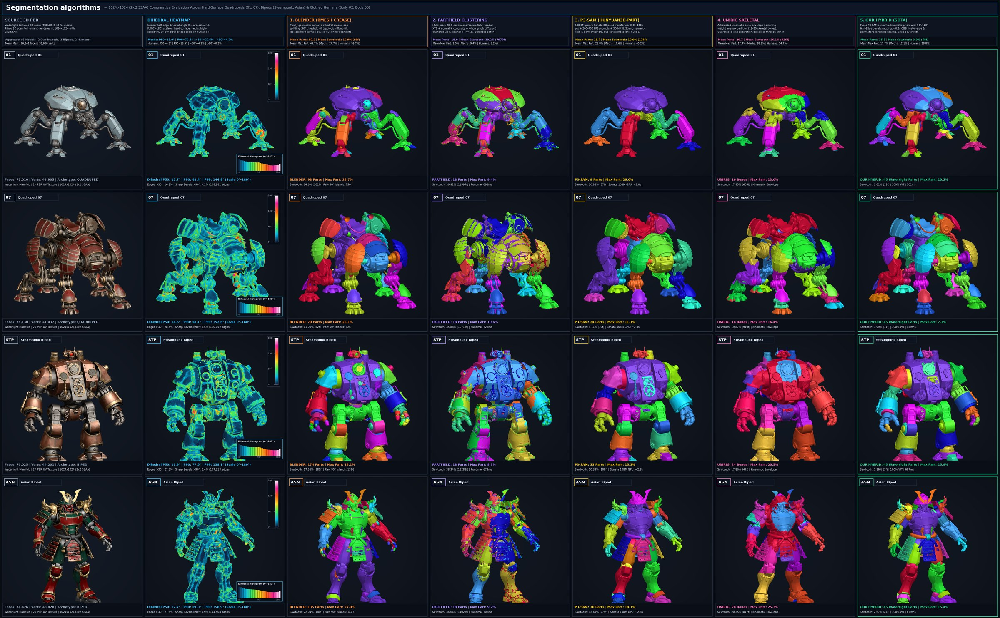
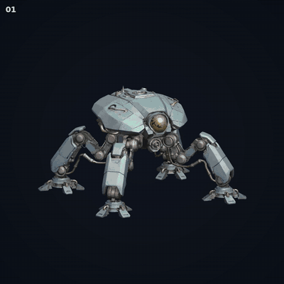

# Preprocess

From a picture to parts the physics engine can use. The mechs went through every step; a model of your own can start
at any of them.



## How the mechs were made

1. **A picture**, made with KREA 2.
2. **A 3D model** made from it by Microsoft's TRELLIS.2: one textured mesh.
3. **Semantic parts.** P3-SAM, from Tencent's Hunyuan3D-Part, splits the mesh (sampled as 100,000 points) into its
   limbs and body modules. Its borders are jagged, so they are moved to the model's own creases: the mesh is cut along
   every edge folded more than 90°, each island between creases joins the semantic part it mostly lies in (an island
   spanning two parts is split between them), small islands such as rivets and bevels merge into their neighbour, and
   open borders are closed. Each part is named after its role, from where it sits in the mech and its shape
   (`part_012_FRONT_SHIN_L`). That makes 34 to 45 parts a mech: the files in [models/](../models/).
4. **Physics parts**, in the engine: each semantic part is split again along its creases (the segmenter that splits
   uploads in the browser), parts that could trap others are cut, and the whole is baked: per part a distance field and
   surface samples, and a joint wherever two parts touch.

Steps 1 to 3 ran outside this repository, with those models installed on a GPU; [models/](../models/) holds what they
made, free to use ([CC0](../models/LICENSE)). Step 4 is below.



How other ways of splitting compare, on mecha_01, mecha_07 and two bipeds: the dihedral angle of every edge, then
Blender's crease split, PartField clustering, P3-SAM alone, UniRig's bones, and the hybrid of step 3 (right).



The semantic parts of four mechs, pulled apart ([video](../docs/media/mechs-one-by-one.mp4); all of them:
[video](../docs/media/mechs-exploded.mp4)).

## Setup

```bash
git clone https://github.com/nicoptere/assemblage.git
cd assemblage/engine
npm install
python3 -m pip install numpy scipy      # for physbake and pack_targets
```

The commands below start from `assemblage/engine` unless they say otherwise.

## Split the mechs again

```bash
npm run resegment-models -w app -- --dry                  # how many parts each mech would get; nothing written
npm run resegment-models -w app -- --angle 60 mecha_03    # mecha_03 cut at creases over 60°, baked, shrunk, tested
npm run dev                                               # then open http://localhost:5173/?model=mecha_03
git checkout -- app/public/models                         # back to the parts the app ships with
```

It reads the mechs in [models/](../models/), keeps their rig ([engine/app/rigs/](../engine/app/rigs/): which part
belongs to which limb), and checks that each mech still stands. Its options are listed at the top of
[resegment-models.mjs](../engine/app/scripts/resegment-models.mjs): `--angle 90`, `--trap-size 0.25`,
`--trap-radius 0.035`, `--trap-wrap 0.33`, `--trap-pieces 6`, `--no-traps`, `--max-parts N`, `--no-check`.

## Bake a model of your own

The quickest way needs nothing: drop a GLB, OBJ or STL on the page, or use the upload tile of the Create gallery. It
is split at its creases and baked in the browser, in a few seconds.

To ship a model with the app, bake a GLB that has one node per part, in its assembled pose:

```bash
cd ../preprocess
python3 -m physbake ../models/mecha_02.glb -o ../engine/app/public/models/my_mech --name my_mech
cd ../engine
npm run optimize-models -w app -- my_mech                 # WebP textures, compressed meshes, gzipped fields
```

Then add `"my_mech"` to [engine/app/public/models/index.json](../engine/app/public/models/index.json), put a picture
for the gallery at `engine/app/public/models/my_mech/thumb.png`, and open `?model=my_mech`.

physbake makes the joints from the parts' names (`part_<n>_<ROLE>`, see [physbake/rig.py](physbake/rig.py)): two parts
of the same limb segment are welded, neighbouring segments of a limb (thigh and shin, shin and paw) and the torso and a
hip or shoulder get a ball joint, and anything else is welded, so a model whose names mean nothing holds together in
one piece. Its options: `--scale` (metres per model unit), `--voxels 160` (across the whole model), `--min-cells 24`
(across a part's longest side), `--samples 60` (sample spacing: model size over this), `--no-render`.

## Add a rebuild target

```bash
cd ..
python3 preprocess/pack_targets.py my_shape.glb -o engine/app/public/targets --max-triangles 60000
```

This keeps only the triangles (node transforms and skinned poses applied) and simplifies them to fit. List the file in
[engine/app/public/targets/index.json](../engine/app/public/targets/index.json), as
`{ "name": "my shape", "file": "my_shape.glb" }`, then make its picture for the gallery:

```bash
cd engine
npm install --no-save playwright && npx playwright install chromium    # once
npm run dev                                                            # in one terminal
npm run thumbs -w app                                                  # in another
```
